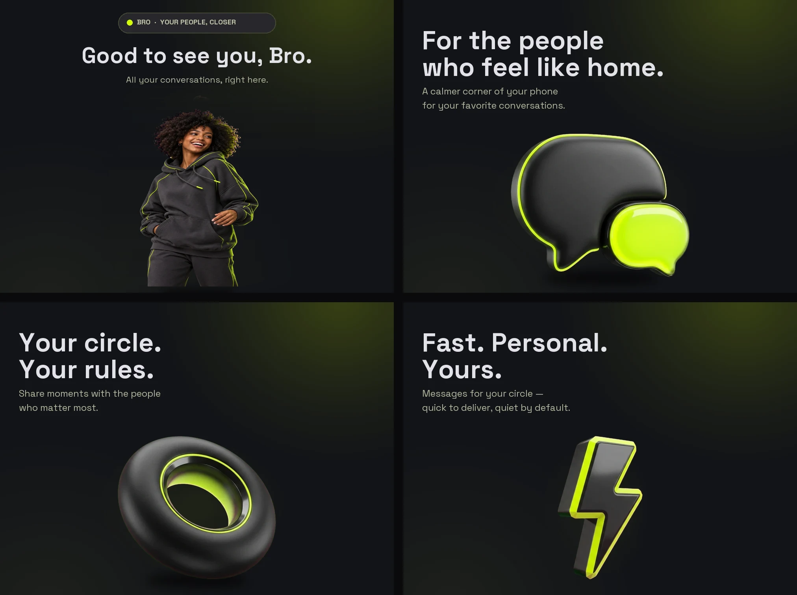

# Auth look pass — design and delivery notes

The BRO auth surfaces (login and onboarding) share one small design system:
Space Grotesk type, an atmospheric backdrop, and **one 3D prop per screen**.
This document is the reference for those decisions so the next change stays
inside the system instead of drifting.

## The one-prop rule

Every auth screen shows exactly one object, lit once, grounded once:

| Screen | Prop | Asset |
| --- | --- | --- |
| Login / sign up | The "Bro" mascot, mid-laugh, hand in her pocket | `prop_mascot.webp` |
| Onboarding 1 — *people* | Two rounded chat bubbles | `prop_chat.webp` |
| Onboarding 2 — *circle* | Charcoal/volt torus | `prop_circle.webp` |
| Onboarding 3 — *fast & personal* | Chunky lightning bolt | `prop_bolt.webp` |

Nothing orbits, floats alongside or decorates around the prop. That is what
keeps the scenes reading as objects in a room rather than as a staged collage
of easter eggs. If a screen needs another idea, it needs its own screen.

*Static 2× composition mock (Space Grotesk copy rendered from the bundled font,
the real prop assets in their real slots). A design reference, not a device
screenshot.*

## Typography — Space Grotesk

Space Grotesk is bundled as static weights (400/500/600/700) in
`assets/fonts/space_grotesk/` and is the app-wide `fontFamily` in `main.dart`.
The auth screens compose from `AppText` tokens only:

- `displayXL` / `displayLG` — onboarding titles.
- `heroTitle` / `heroTitleCompact` — login hero and compact header.
- `eyebrow` — the uppercase chip above the login headline.
- `fieldLabel`, `body`, `caption`, `button`, `wordmark` — form and footer copy.

Letter spacing is negative on display sizes (`-1.8` at 42 px, `-0.8` at 28 px)
and positive on the 9 px eyebrow (`1.05`). Do not add one-off `fontSize`
values; extend `AppText` instead. No type is baked into the artwork, so copy
changes never require a re-render.

## Artwork

All four props are original BRO renders: matte charcoal surfaces
(`#121318`–`#292A2F`) with volt-lime (`#D4FF00`) bevels, one studio key light
from the upper left, no baked floor and no glow spill into the background. The
app adds the halo and the contact shadow, so a prop sits on the backdrop
instead of on a card.

They were rendered on a flat magenta chroma field and keyed to alpha with a
"magenta-ness" ramp (`min(R, B) − G`), then un-mixed and despilled. See
[`assets/images/ASSET_SOURCES.md`](../assets/images/ASSET_SOURCES.md) for the
full pipeline and the file sizes (~167 KB total, WebP q92).

`AuthArt` in `lib/screens/auth/widgets/auth_prop.dart` is the single Dart
reference to the files; `pubspec.yaml` lists them.

## Motion — quiet support, never the subject

`AuthProp` renders one prop with:

- a slow idle float (11 s loop, ±5 px) and a whisper of yaw (±0.05 rad),
- pointer parallax (the prop leans up to ~10 px, the shadow tracks it),
- a soft static halo and a contact shadow.

`WelcomeHero` adds a 1.1 s staggered entrance (eyebrow → headline → subhead →
prop) using `HeroEntrance`. Onboarding keeps its existing per-page entrance.

There are no orbiting props, no counter-rotating rings and no scene timeline
any more — the old `HeroOrbitPose` maths was removed with them.

### Reduce motion

`reduceMotionOf(context)` is the single switch. Under reduce motion:

- `AuthProp` never starts its idle controller and reports a zero parallax
  shift, so it renders as a still object;
- `WelcomeHero` renders the completed intro (rest pose);
- onboarding page entrances jump to their end state.

Because nothing repeats, `pumpAndSettle` in tests completes — that behaviour is
covered by `test/welcome_hero_test.dart` and `test/onboarding_screen_test.dart`.

## Layout

- **Login**: the prop is the *background of the page* — `AuthPropBackdrop`
  pins her to the right and bottom on wide layouts (mirrored, so she faces back
  into the form) and across the top on phones, behind a scrim that keeps the
  copy and the fields legible. The copy and the form then share one 420 px
  column on the left; `WelcomeHero` renders copy-only there (`showProp: false`).
  On short screens and while the keyboard is open the copy collapses to the
  compact header, but the background prop stays — it is the page, not a panel.
- **Onboarding**: each page keeps a 278 px artwork slot under the subtitle; the
  prop is centred in it (chat 214, circle 232, bolt 244).

## Performance guardrails

- One `AnimationController` per prop (idle) plus one per hero/page entrance; no
  per-child controllers and no merged scene timeline.
- Props are pre-resized assets (~2× on-screen size) drawn with
  `FilterQuality.medium` + `gaplessPlayback`.
- Decorative nodes are `IgnorePointer` + `ExcludeSemantics`; the headline,
  subhead and card copy remain the accessible content.

## Tests

- `test/hero_motion_test.dart` — entrance rest pose, parallax enabled/disabled.
- `test/welcome_hero_test.dart` — the hero is exactly one prop (the mascot) plus
  copy, sign-up copy swap, reduce-motion settle, idle float runs cleanly.
- `test/onboarding_screen_test.dart` — each page shows exactly one prop, and the
  walkthrough still reaches login.
- `test/login_screen_test.dart` — form, validation and the reduce-motion build.

## Delivery history

1. **Type + atmosphere** — Space Grotesk bundle, `AppText` tokens,
   `AuthBackdrop` (#114).
2. **Artwork** — first hero props (#115).
3. **Motion** — expressive orbit choreography (#115).
4. **This refinement** — replaced the orbit collage with one prop per screen,
   added the three onboarding props, deleted the hand-drawn artwork and the
   orbit maths.
