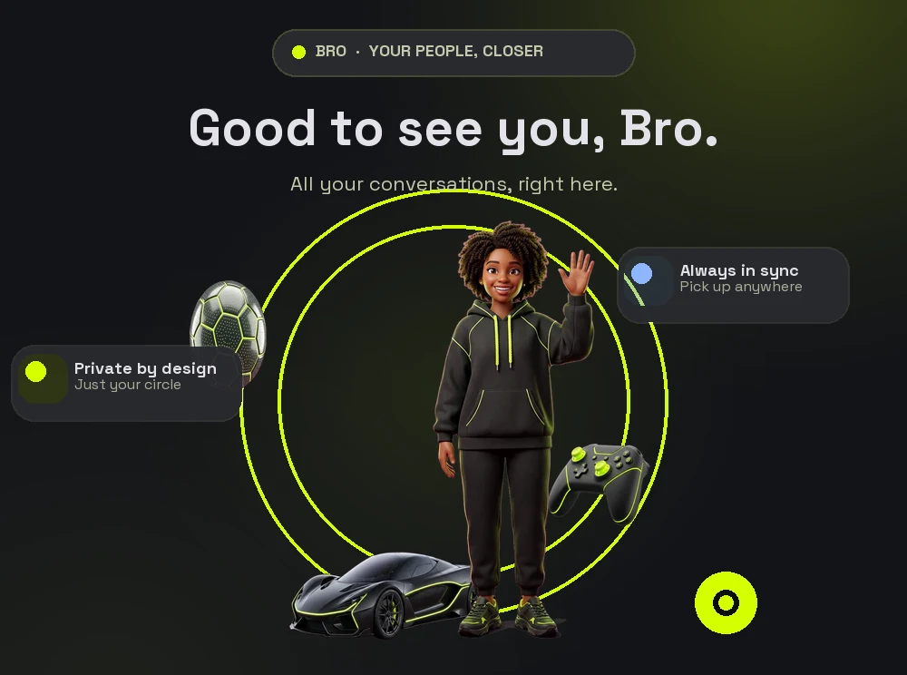

# Auth look pass — design and delivery notes

The BRO auth surfaces (login and onboarding) were rebuilt in a four-part look
pass. This document is the reference for the typography, artwork and motion
decisions so the next change stays inside the same system instead of drifting.

## Scope

| Part | Theme | Surface | Status |
| --- | --- | --- | --- |
| 1 | Space Grotesk type scale + atmospheric backdrop | `app_text.dart`, `auth_backdrop.dart`, both auth screens | merged (#114) |
| 2 | Regenerated hero artwork (four props) | `assets/images/hero_*`, `ASSET_SOURCES.md` | this pass |
| 3 | Expressive hero choreography | `hero_motion.dart`, `welcome_hero.dart` | this pass |
| 4 | Tests, docs, performance guardrails | `test/hero_motion_test.dart`, `test/welcome_hero_test.dart`, this file | this pass |

Nothing in the pass changes auth behaviour: same routes, same strings, same
Supabase calls, same validation. It is entirely presentation.

## Typography — Space Grotesk

Space Grotesk is bundled as static weights (400/500/600/700) in
`assets/fonts/space_grotesk/` and is the app-wide `fontFamily` in `main.dart`.
The auth screens compose from `AppText` tokens only:

- `displayXL` / `displayLG` — onboarding hero titles.
- `heroTitle` / `heroTitleCompact` — login hero and compact header.
- `eyebrow` — the uppercase chip above the hero headline.
- `fieldLabel`, `body`, `caption`, `button`, `wordmark` — form and footer copy.

Rules of thumb: letter spacing is negative on display sizes (`-1.8` at 42 px,
`-0.8` at 28 px) and positive on the 9 px eyebrow (`1.05`). Do not add one-off
`fontSize` values; extend `AppText` instead. All lettering in the artwork is
live text — no type is baked into the images, so copy changes never require a
re-render.

## Artwork — four original hero props

*Static composition mock of the hero at 2× (Space Grotesk copy rendered from the
bundled font, the four generated props on their orbit paths). It is a design
reference, not a device screenshot; the live scene adds parallax, entrance and
depth-sorted orbits.*

| Asset | Role | Intrinsic | On disk |
| --- | --- | --- | --- |
| `hero_mascot.webp` | The "Bro" mascot, waving | 560 × 1003 | ~70 KB |
| `hero_ball.webp` | Charcoal/volt football orb | 300 × 210 | ~20 KB |
| `hero_gamepad.webp` | Charcoal/volt controller | 480 × 283 | ~21 KB |
| `hero_supercar.webp` | Original graphite/volt supercar | 512 × 229 | ~26 KB |

Art direction: near-black charcoal surfaces (`#121318`–`#292A2F`) with volt-lime
(`#D4FF00`) emissive accents, soft-touch matte materials, chrome edge light, no
baked floor or shadow. That is the same "Electric Street" palette the UI uses, so
the props read as part of the product rather than stock 3D renders.

The props replace four third-party transparent PNGs (a blue football, a stock
controller, a yellow Lamborghini and a portrait render) whose commercial-use
terms had never been verified. The new set is original work with no attribution
requirements — see [`assets/images/ASSET_SOURCES.md`](../assets/images/ASSET_SOURCES.md)
for the generation and chroma-key pipeline.

Total hero artwork weight dropped from ~715 KB of PNG to ~140 KB of WebP.

## Motion — expressive, but one timeline

Motion is deliberately **expressive** on the hero and still disciplined
everywhere else. Two controllers drive the whole scene:

- `_loop` — 16 s repeating loop: orbits, bob, halo breathing, ring rotation,
  bead pulse.
- `_intro` — 1.25 s one-shot: staggered entrance.

The reusable pieces live in `lib/ui/hero_motion.dart`:

- **`HeroOrbitPose`** — pure function of a `0..1` phase: elliptical offset,
  depth (`-1` far … `1` near), depth-based scale, yaw and roll. Props with
  `depth < 0` paint behind the mascot, `depth >= 0` in front, sorted by
  `sortKey`.
- **`HeroEntrance`** — fade + rise + settle for one element of a stagger,
  driven by the intro animation.
- **`HeroParallax`** — normalised pointer shift (`-1..1`) with easing, for hover
  on desktop/web and drags on touch.

Choreography in `welcome_hero.dart`:

1. Halo breathes, two orbit rings counter-rotate.
2. Eyebrow, headline, subhead settle in, then the mascot, then the props, then
   the floating cards and the message bead.
3. The mascot travels an elliptical depth path (yaw ±0.3 rad, depth scale
   0.95–1.05) with a contact shadow that fades as she lifts.
4. The ball, controller and supercar orbit her torso on their own paths; the
   supercar runs a slower 0.92 loop so the motion never looks uniform.
5. Pointer movement leans the stage: the mascot counter-moves, each prop reacts
   with its own parallax weight (18–30 px per unit of shift).

### Reduce motion

`reduceMotionOf(context)` is the single switch. When the OS asks for reduced
motion the hero renders a **rest pose** — intro at `1`, loop phase `0`, zero
parallax — and both controllers are stopped, not merely hidden. The loop never
starts, so `pumpAndSettle` in tests completes. This is covered by
`test/welcome_hero_test.dart`.

### Performance guardrails

- One `AnimatedBuilder` on a merged listenable rebuilds the stage; no per-child
  controllers.
- Props are pre-resized assets (no runtime decode of huge images) drawn with
  `FilterQuality.medium` and `gaplessPlayback`.
- The stage is a fixed 372 px box; nothing in it triggers layout on each frame
  (only transforms, opacity and gradients).
- All decorative nodes are `IgnorePointer` + `ExcludeSemantics`; the headline,
  subhead and cards remain the accessible content.
- Assets are WebP q92, trimmed to the silhouette.

## Tests

- `test/hero_motion_test.dart` — orbit pose maths, depth sorting, entrance rest
  pose, parallax on/off.
- `test/welcome_hero_test.dart` — every regenerated asset renders, sign-up copy
  swap, feature-card toggle, reduce-motion settle, loop runs without errors.
- `test/login_screen_test.dart` — unchanged; still asserts the form, inline
  validation and the reduce-motion build.

## Delivery

The pass is split into four reviewable PRs so each layer can be reviewed (and
reverted) on its own:

1. **Type + atmosphere** — Space Grotesk bundle, `AppText` tokens,
   `AuthBackdrop` (#114).
2. **Artwork** — regenerate all four hero props, update `pubspec.yaml`,
   rewrite the asset provenance notes.
3. **Motion** — `hero_motion.dart` primitives and the rebuilt `WelcomeHero`.
4. **Polish** — tests, this document, performance and accessibility guardrails.
